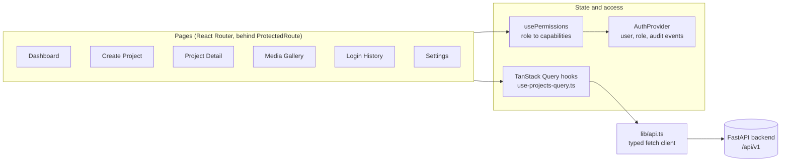
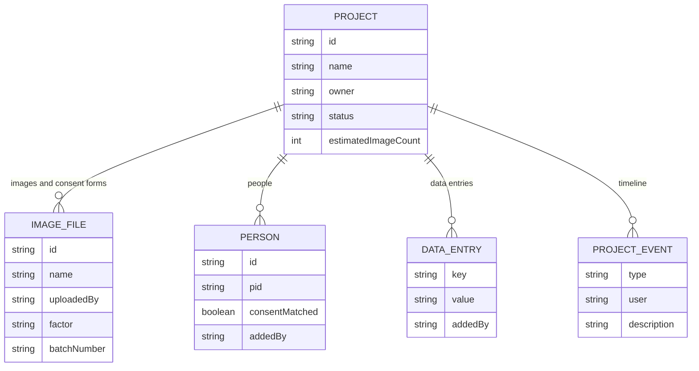

# Consent Map: Admin Portal

Role-based admin front end for Consent Map, a system that matches people detected in images to their consent records. Built with React, TypeScript and TanStack Query against a FastAPI backend.

`React 18` `TypeScript` `Vite` `Tailwind CSS` `shadcn/ui` `TanStack Query` `React Router`

<p>
<picture>
  <source media="(prefers-color-scheme: dark)" srcset="docs/pipeline-dark.svg">
  
</picture>
</p>

## Where this fits

Consent Map was built during a project internship with Samsung R&D. The full system detects people in images with YOLOv8 and RetinaFace, matches identities through FAISS vector search, and exposes the results through FastAPI services.

This repository is the last stage of that pipeline: the portal where an operator creates capture projects, reviews images and consent forms, tracks which people have matched consent, and audits who signed in. The detection and matching services are not part of this repository.

## What the portal does

| Area | Route | What it covers |
| --- | --- | --- |
| Projects | `/dashboard` | Searchable project list with status filter (active, completed, on hold) |
| Create project | `/create-project` | Name, owner, target image count, camera types (DSLR, mobile) and the PII types the project will contain (faces, objects, documents, other) |
| Project detail | `/project/:id` | Tabs for all images, unique images and consent forms, with the people attached to the project and whether their consent is matched |
| Media gallery | `/database-details` | Every uploaded image and consent form across projects, in one grid |
| Media detail | `/image-details/:fileName` | A single image or consent form |
| Redaction | `/redaction` | Redaction queue (interface only, see Status) |
| Login history | `/login-history` | Audit trail of login, logout and sign-up events |
| Settings | `/settings` | Account details, consent validity period, default consent status, and blocking uploads after consent expires |

## Architecture



**Server state** goes through TanStack Query. `use-projects-query.ts` wraps the API client in `useQuery` and `useMutation` hooks, and mutations invalidate the `projects` key so lists refresh without manual refetching.

**Access control** is resolved in one place. `usePermissions` turns the signed-in role into a set of capabilities, and components ask for a capability (`canEdit`, `canViewConsent`) instead of checking roles themselves.

**Routing** wraps every portal page in `ProtectedRoute`, which redirects unauthenticated visitors to `/login`.

### Roles and permissions

| Capability | Admin | Collaborator | User |
| --- | :---: | :---: | :---: |
| Add people, images and data entries | Yes | Yes | Yes |
| Upload files | Yes | Yes | Yes |
| Edit or delete records | Yes | No | No |
| View the consent section | Yes | Yes | No |
| Edit consent settings | Yes | No | No |
| View login history | Yes | Yes | No |
| Clear login history | Yes | No | No |

### Data model



`factor` records the lighting condition of an image (normal, dark, bright or custom). `consentMatched` is the field the whole system exists to fill in: whether a detected person has a verified consent record.

### Backend contract

The client in `src/lib/api.ts` expects a JSON envelope of the form `{ "data": ... }` from these endpoints:

| Method | Endpoint | Used by |
| --- | --- | --- |
| `GET` | `/api/v1/projects` | Dashboard, media gallery |
| `GET` | `/api/v1/projects/{id}` | Project detail |
| `POST` | `/api/v1/projects` | Create project |
| `DELETE` | `/api/v1/projects/{id}` | Project detail (admin only) |

## Getting started

```bash
npm install
npm run dev
```

The app runs on `http://localhost:8080` and expects the backend at `http://localhost:8000/api/v1`. To point it elsewhere, change `API_BASE` in `src/lib/api.ts`.

Three demo accounts (admin, collaborator and user) are seeded in `src/lib/auth.tsx` so each role can be tried without a backend user store.

| Script | Purpose |
| --- | --- |
| `npm run dev` | Development server |
| `npm run build` | Production build |
| `npm run preview` | Serve the production build |
| `npm run lint` | ESLint |

## Project structure

```
src/
├── App.tsx                    Providers and route table
├── pages/                     One file per route
├── components/
│   ├── ProtectedRoute.tsx     Auth guard
│   ├── layout/                Dashboard shell and sidebar
│   ├── projects/              Project card
│   └── ui/                    shadcn/ui primitives
├── hooks/
│   ├── use-projects-query.ts  TanStack Query hooks
│   └── use-permissions.ts     Role to capability mapping
└── lib/
    ├── api.ts                 Typed API client
    ├── auth.tsx               Auth context and audit events
    └── types.ts               Domain types
```

## Status

- Listing, viewing, creating and deleting projects are wired to the backend.
- Adding people, images, consent forms and edits from the project page are built in the interface but not yet connected. They currently report "API integration pending".
- The redaction module is a layout with placeholder figures, not a working queue.
- Authentication is a client-side demo. Users, the session and the login audit trail are kept in `localStorage`, and passwords are not hashed. It needs server-side authentication before any real deployment.
- The API base URL is a constant in the source and should move to an environment variable.

---

Built by [Yogdeep Benchimath](https://github.com/Yogdeep2004). More work on the [portfolio](https://deepwork-systems.vercel.app/).
